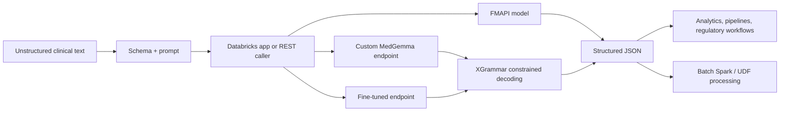

# Structured AI for Life Sciences on Databricks

This repository showcases how to deliver production-grade structured extraction from unstructured clinical text on Databricks, even when the best-performing model is a custom or fine-tuned model served from Unity Catalog.

## The Problem

Databricks `ai_query` in SQL and AI Functions can enforce structured JSON output for Foundation Model API models, but custom and fine-tuned models served from Unity Catalog typically return raw text. For life sciences workloads, regex cleanup is not strong enough for regulatory, analytics, or downstream pipeline use cases.

This repo demonstrates how to close that gap with:

- domain-specific models such as MedGemma
- XGrammar-constrained decoding for schema-valid JSON
- Databricks Model Serving for online inference
- Spark and Serverless GPU Compute paths for batch inference
- optional PEFT fine-tuning for domain adaptation

## Why This Matters for Life Sciences

Clinical language is specialized. Abbreviations, drug names, procedures, ICD-style terminology, and note structure often reduce the quality of general-purpose models. Life sciences teams need:

- higher extraction accuracy on clinical language
- deterministic structured output for downstream systems
- scalable batch processing
- a practical path from prototype to production

## What This Repo Demonstrates

- **FMAPI-first structured extraction**
  Lowest-complexity path when Foundation Model API accuracy is good enough.
- **Domain model + XGrammar**
  A custom model serving path for better clinical extraction quality with guaranteed JSON output.
- **Fine-tuned model + XGrammar**
  A path for customer-specific terminology or workflow-specific extraction tasks.
- **Interactive comparison UI**
  A Databricks app to compare FMAPI and custom endpoints side by side.
- **Distributed batch inference**
  Spark and SGC-based options for scaling extraction across large note volumes.

## Decision Framework

1. Start with `ai_query` and a Foundation Model API model if accuracy is acceptable.
2. Move to a domain model plus XGrammar if clinical extraction quality needs to improve.
3. Add PEFT fine-tuning plus XGrammar if the terminology or output quality still is not sufficient.

See [showcase/decision-framework.md](showcase/decision-framework.md) for the customer-facing version of this decision tree.

## Architecture



## Repo Tour

- [showcase/overview.md](showcase/overview.md): business story and technical thesis
- [showcase/decision-framework.md](showcase/decision-framework.md): when to use FMAPI, domain models, or fine-tuning
- [showcase/workloads](showcase/workloads): first-class life sciences workload packs
- [showcase/demos](showcase/demos): guided runnable demo flows
- [docs/quickstart.md](docs/quickstart.md): fastest way to deploy and walk through the repo
- [docs/demo-runbook.md](docs/demo-runbook.md): customer-facing field demo script

## Execution Layer

The repo keeps the current runnable implementation paths unchanged:

- `src/medgemma`: MedGemma registration, serving, and benchmark flow
- `src/vllm`: alternate custom serving path for MedGemma and Qwen
- `src/batch`: scalable batch inference paths
- `src/finetune`: PEFT fine-tuning flow
- `src/app`: interactive comparison cockpit

See [docs/architecture.md](docs/architecture.md) for the capability-to-code map.

## Quickest Demo Paths

- **Interactive comparison**
  Deploy the app and compare FMAPI models against custom endpoints.
- **Custom structured extraction**
  Register and deploy MedGemma with XGrammar, then run extraction against a workload schema.
- **Batch pipeline**
  Prepare sample input and run either the UDF or SGC batch path.
- **Fine-tuned extraction**
  Run `finetune_qwen3_disease` to adapt Qwen3-4B to NCBI Disease Corpus annotations, then compare its vLLM endpoint with the base Qwen endpoint in the app.

## Workspace Prerequisite for Model Jobs

Registration and the Serverless GPU batch path use the Unity Catalog volume path `/Volumes/<catalog>/<schema>/model_weights/...`. Create the `model_weights` volume before running those jobs. With the default target:

```sql
CREATE VOLUME IF NOT EXISTS pavan_naidu_catalog.mlops.model_weights;
```

See [docs/quickstart.md](docs/quickstart.md) for the complete setup and deployment sequence.

## Validation Commands

```bash
databricks bundle validate --profile FEVM
cd src/app && python -m pytest tests
cd src/app/frontend && npm run typecheck
cd src/app/frontend && npm run build
```

## Customer Context

This showcase is designed for field demos and customer conversations around structured AI in life sciences, including scenarios like:

- EHR and clinical note extraction
- adverse event reporting
- clinical trial data capture
- prior authorization
- drug interaction screening

Historical benchmark and optimization notes are available under [docs/reference](docs/reference).
