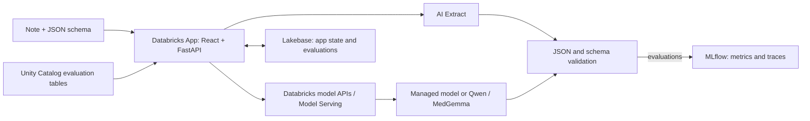

# Clinical Extractor — structured AI for MedTech and life sciences

Clinical Extractor turns clinical narrative into schema-checked records and lets a
reviewer compare AI Extract, Foundation Model APIs, Qwen, and MedGemma on the same
input. It includes a FastAPI/React app, ground-truth evaluations, load tests, and
Databricks jobs for custom serving, batch extraction, and QLoRA fine-tuning.

## Business problem and use case

A MedTech clinical-operations team building a follow-up worklist needs the action
and its timing, not just a fluent summary. In the bundled **EHR Note Extraction**
fixture, the clinician recommends a chest X-ray **in six weeks** and a primary-care
visit **next week**. A reviewer must preserve that distinction while also extracting
diagnoses, medication regimens, and vitals. Well-formed JSON can still assign the
wrong timeframe to an action.

The demo makes that handoff inspectable: submit the note and schema, compare model
outputs, check the extracted facts against the source, then measure validity,
field agreement, latency, and token usage. Start with a managed model and use
reviewed evaluation results to decide whether custom weights or fine-tuning help.

**Recorded operational outcome:** the November 18, 2026 smoke run produced
**20/20 schema-valid output rows in each of three batch paths**: classic GPU driver,
Spark SQL `ai_query`, and Serverless GPU/Ray. That is 60 outputs from the same 20
synthetic inputs. See [measurements and limitations](docs/benchmarks.md).
This establishes execution and output shape; clinical accuracy needs separately
reviewed ground truth.

## Named data and sources

| Data | Source and role |
|---|---|
| **EHR Note Extraction** (`ehr_note_extraction`) | Repository-authored synthetic pneumonia follow-up note in [built-in presets](src/app/api/presets.py), also provided with a schema, prompt, and review checklist in the [EHR workload pack](showcase/workloads/ehr-clinical-notes/README.md). This is the opening demo. |
| **Life Sciences Workload Packs** | Five repository-authored synthetic cases: [EHR notes](showcase/workloads/ehr-clinical-notes/README.md), [adverse events](showcase/workloads/adverse-event-reporting/README.md), [trial screening](showcase/workloads/clinical-trial-data-capture/README.md), [prior authorization](showcase/workloads/prior-authorization/README.md), and [drug interactions](showcase/workloads/drug-interaction-screening/README.md). Each includes its actual input files. |
| **MedGemma Synthetic Batch Input** (`medgemma_batch_input`) | [Preparation notebook](src/models/medgemma/batch/01_prepare_batch_input.py): 20 fixed seed records across seven extraction categories. The default 50 replications create 1,000 rows; replication tests throughput without adding clinical diversity. |
| **NCBI Disease Corpus** (`ncbi/ncbi_disease`) | [Public biomedical disease-annotation dataset](https://huggingface.co/datasets/ncbi/ncbi_disease), loaded by the [Qwen fine-tuning notebook](src/models/qwen/finetune_disease.py) at revision `ddf78b541d0004431f0eee441e439b7881e6213d`. Its token-level disease annotations become JSON training targets. This optional path uses published biomedical text, separate from the synthetic app fixtures. |

The shipped clinical examples are synthetic. The NCBI corpus is a named public
research source, not a customer dataset. Workload `expected-fields.md` files are
review checklists; scored evaluations require reviewed JSON answers, as shown in
[the evaluation setup](docs/setup.md#run-a-scored-evaluation). The
[data-source guide](docs/data.md) records fixture counts, revisions, and transformations.

## Technical architecture



- **Online extraction:** the backend translates each endpoint's schema contract
  and validates the returned JSON. Custom endpoints use XGrammar through the
  MedGemma ChatModel or vLLM guided decoding.
- **Persistence and access:** Unity Catalog holds models and input/output tables;
  Lakebase holds presets, settings, and evaluation runs. Evaluation dataset reads
  use the signed-in user's token through a SQL warehouse.
- **Model lifecycle:** separate jobs download/register models, deploy endpoints,
  prepare Delta inputs, run batch inference, or fine-tune Qwen/MedGemma. Deploying
  the app does not execute these jobs.

Model calls use Databricks interfaces and app resource bindings. Configure AI
Gateway policies on the serving endpoints used by your workspace. See the
[module and resource map](docs/architecture.md) for implementation details.

## Prerequisites

| Area | Required before deployment |
|---|---|
| Local tools | Git, Python **3.12**, Node.js **20 or 22** with npm, and Databricks CLI **1.26.0** (the version used to verify these commands) or a compatible newer release. |
| Workspace | Databricks Apps, Unity Catalog, a running SQL warehouse, and an existing Lakebase project, branch, and database. The bundle binds these existing resources. |
| Permissions | Permission to deploy the app and grant its resource bindings; access to the selected catalog/schema and evaluation table; `CAN_USE` on the warehouse and `CAN_QUERY` on serving endpoints. |
| Extraction backends | AI Extract access (`system.ai.ai_extract`) and the model endpoints retained in [app resource bindings](resources/clinical_extractor.app.yml). Availability varies by workspace and region. |
| Optional GPU workflows | Access to the requested GPU compute, Unity Catalog model registration, and the volumes described in [model-job setup](docs/setup.md#model-jobs). MedGemma also requires approval for its Hugging Face weights and a token stored in a Databricks secret scope. |

Use the [CLI installation guide](https://docs.databricks.com/aws/en/dev-tools/cli/install)
if the Databricks CLI is not already installed.

The default bindings name several managed and custom endpoints. Before using a
new workspace, retain the endpoints you actually have and align
[app bindings](resources/clinical_extractor.app.yml), [model defaults](src/app/models.json),
and [app environment bindings](src/app/app.yaml). For a managed-only demo, remove
unavailable custom bindings and selections. Keep the `gpt-5-4-mini` binding used by
`ENDPOINT_NAME`, or update that environment binding to your replacement.

## Install and deploy

The complete [setup and operations guide is provided at `docs/setup.md`](docs/setup.md).
The sequence below starts from a fresh clone.

### 1. Clone and install the locked dependencies

```bash
git clone https://github.com/databricks-field-eng/clinical-extractor.git
cd clinical-extractor
python3.12 -m venv .venv
source .venv/bin/activate
python -m pip install -r src/app/requirements-dev.txt
npm --prefix src/app/frontend ci
```

`requirements.txt` and `requirements-dev.txt` pin transitive Python dependencies.
Use your organization's configured package mirror if direct package access is
restricted. [Dependency maintenance](docs/setup.md#python-dependency-locks) explains
how to regenerate the locks.

### 2. Authenticate to your workspace

Replace the host placeholder with your workspace host. An existing CLI profile can
be selected instead by setting `DATABRICKS_CONFIG_PROFILE` to its name.

```bash
export DATABRICKS_HOST="https://<your-workspace-host>"
export DATABRICKS_CONFIG_PROFILE="clinical-extractor"
databricks auth login --host "$DATABRICKS_HOST" --profile "$DATABRICKS_CONFIG_PROFILE"
```

Keep the profile environment variable set for the commands below.

### 3. Supply local resource values

Create the local override directory:

```bash
mkdir -p .databricks/bundle/dev
```

Add or update `.databricks/bundle/dev/variable-overrides.json` using the template
below. Replace every placeholder with an existing resource value. A new app name
must be unique in the workspace, use lowercase letters, digits, and hyphens, and
contain at most 30 characters. Preserve the current `app_name` when updating an
existing deployment.

```json
{
  "app_name": "<unique-app-name>",
  "catalog": "<catalog>",
  "schema": "<schema>",
  "lakebase_project": "<project-id>",
  "lakebase_branch": "<branch-id>",
  "lakebase_database": "<database-id>",
  "evaluation_warehouse_id": "<warehouse-id>",
  "hf_secret_scope": "<secret-scope>"
}
```

This file is ignored by Git. Omit `hf_secret_scope` for a managed-only app; it is
consumed by MedGemma jobs. For those jobs, put the Hugging Face token in the scope
under `hf_secret_key` (default `hf_token`). For CI,
use `BUNDLE_VAR_<variable-name>` values. [Bundle configuration](docs/setup.md#configure-the-bundle)
lists the variables and resource prerequisites.

### 4. Build, review, deploy, and start

After aligning the endpoint bindings described above, run:

```bash
npm --prefix src/app/frontend run build
databricks bundle validate --strict --target dev
databricks bundle plan --select apps.clinical_extractor,experiments.clinical_extractor_evaluations --target dev
databricks bundle deploy --select apps.clinical_extractor,experiments.clinical_extractor_evaluations --target dev
databricks bundle run clinical_extractor --target dev
databricks bundle summary --target dev
```

Review the plan before deployment. Open the app URL shown by the CLI. The targeted
deployment includes the evaluation experiment referenced by the app. The app
initializes Lakebase tables and seeds its built-in presets on startup.

### 5. Verify a concrete extraction

1. Open **EHR Note Extraction** in the app, or paste the note, schema, and system
   prompt from the [EHR workload pack](showcase/workloads/ehr-clinical-notes/README.md).
2. Select an available managed model. Add a custom endpoint for comparison if it
   has been deployed and bound to the app. Use base Qwen or MedGemma for this EHR
   task; evaluate the disease-only fine-tuned Qwen on its own training contract.
3. Run extraction. Check schema validity, then read the values against the note:
   chest X-ray in **six weeks**, primary care **next week**, heart rate **82**, and
   oxygen saturation **96 percent**. A syntactically valid wrong value fails review.
4. Record latency and token usage. For a numeric field-agreement score, use the
   [one-row scored-evaluation recipe](docs/setup.md#run-a-scored-evaluation), then
   extend it with independently reviewed examples.

[The presenter runbook](docs/demo-runbook.md) covers the live conversation.
Custom GPU endpoints may need several minutes to warm after scaling to zero;
retry after startup if the app returns its bounded cold-start timeout.

## Local development and optional workflows

Run the backend and frontend in separate terminals from the cloned repository:

```bash
# Backend, with the Python virtual environment active:
cd src/app
uvicorn main:app --reload --port 8000
```

```bash
# Frontend, from the repository root:
npm --prefix src/app/frontend run dev
```

Vite proxies `/api` to the backend. Without Lakebase, built-in presets and in-memory
settings work; preset writes and evaluations require the configured database.
[Local development](docs/setup.md#local-development) describes the environment.

For custom models, use [model-job setup](docs/setup.md#model-jobs) and the
[source guide](src/README.md). The main job sequences are:

| Goal | Jobs |
|---|---|
| Base Qwen comparison | `inference_vllm_qwen` |
| Qwen disease-extraction fine-tuning | `finetune_qwen3_disease` |
| MedGemma + XGrammar | `medgemma_register` → `medgemma_deploy` → `medgemma_benchmark` |
| MedGemma vLLM | `medgemma_vllm` |
| Batch extraction | `prepare_batch_input` → `batch_inference_udf` or `batch_inference_sgc` |
| MedGemma fine-tuning | `finetune_medgemma` |

New custom endpoints must exist before attaching their bindings to an app. The
setup guide explains how to deploy selected model jobs first. Keep the bundle name
`medgemma` and resource keys stable when continuing an existing deployment.

## Validation and measurable outcomes

```bash
python -m pytest tests src/app/tests -q
npm --prefix src/app/frontend run typecheck
npm --prefix src/app/frontend run build
databricks bundle validate --strict --target dev
```

Use schema-valid output percentage for structural reliability, reviewed
field-agreement and fully-correct-record scores for extraction quality, and latency
percentiles or batch completion time for delivery. Define acceptance thresholds on
held-out examples before choosing a model. The app supports up to 100 evaluation
rows per run; benchmark larger populations with a separate evaluation design.

The [benchmark guide](docs/benchmarks.md) records the measured smoke results and
limitations. Tiny training runs establish that training, registration, and serving
execute; they do not establish clinical effectiveness or a quality improvement.

## Ownership and support

Repository owner: [Databricks Field Engineering](https://github.com/databricks-field-eng).
For setup questions, defects, or contributions, [open a repository issue](https://github.com/databricks-field-eng/clinical-extractor/issues)
with the code revision, failing job or endpoint contract, and a synthetic reproducer.
Workspace access and resource grants are managed by your workspace administrators.

## Repository guide

| Location | Purpose |
|---|---|
| [databricks.yml](databricks.yml), [resources/](resources/) | Bundle variables, targets, app bindings, experiments, and jobs |
| [src/app/](src/app/) | FastAPI backend, React frontend, built assets, and backend tests |
| [src/models/qwen/](src/models/qwen/), [src/models/medgemma/](src/models/medgemma/) | Serving, fine-tuning, batch, and benchmark notebooks |
| [showcase/](showcase/) | Narrative, workload packs, and walkthroughs |
| [docs/](docs/README.md) | Setup, architecture, data sources, benchmarks, and operations |

Generated reports in `output/`, local history in `docs/archive/`, caches, and editor
settings are ignored. Setup instructions, workload files, lockfiles, and the
prebuilt app assets remain shared so another developer can reproduce the demo.
