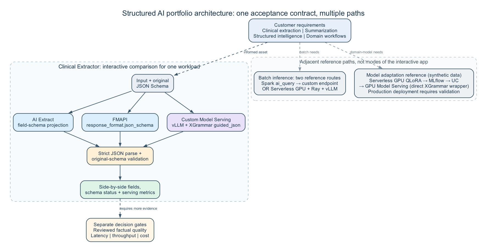

# Architecture

Clinical Extractor uses one clinical note and requested JSON schema to compare
managed extraction, Foundation Model APIs, and custom Model Serving endpoints.
The app validates returned JSON independently of the model's decoding contract.
Batch inference and fine-tuning are separate notebook workflows.

The diagram maps the extraction and model-workflow portfolio. Its
[Graphviz source](diagrams/clinical-extractor-portfolio.dot) can be regenerated;
the [editable XML](diagrams/clinical-extractor-portfolio.xml) is available for
Lucid Chart import.

## Interactive app

`src/app/` contains a FastAPI backend and a React/Vite frontend. `main.py` registers
the API under `/api/v1`, initializes Lakebase on startup, and serves the built SPA
and the `/info` presentation from `static/`.

| Module | Responsibility |
|---|---|
| `api/routes.py` | Model discovery and settings, presets, inference orchestration, and load-test runs |
| `api/ai_extract.py` | JSON Schema conversion, AI Extract request construction, and response evidence parsing |
| `api/json_output.py` | Strict response schemas, prediction normalization, and JSON validation details |
| `api/evaluations.py` | Dataset discovery, ground-truth preflight, background evaluation, and MLflow reporting |
| `api/database.py` | Lakebase credentials, schema initialization, presets, settings, and evaluation persistence |
| `api/schemas.py` | API request and response models |
| `api/presets.py` | Built-in schemas, prompts, and examples |
| `models.json` | Initial endpoint selection, explicit request contracts, and default inference options |

The frontend source is in `frontend/src/`; `frontend/public/` owns the presentation
and public assets. `npm run build` regenerates `static/`, which is tracked because
Databricks Apps serves it directly.

Lakebase stores presets, per-user model settings, output estimates, and evaluation
runs and results. The Postgres app binding supplies connection settings, and the
backend refreshes OAuth database credentials through `LAKEBASE_ENDPOINT`. Without
a configured database the app serves built-in presets and keeps model selections
in memory; preset writes and evaluations require persistence.

Evaluation dataset discovery and queries run with the signed-in user's forwarded
token through the bound SQL warehouse. A background evaluation runs the same
inference path used by interactive extraction, saves row results to Lakebase, and
logs metrics and traces to the bound MLflow experiment. App startup marks unfinished
evaluation runs as interrupted. Load tests use process-local background tasks with
bounded concurrency and runtime.

## Serving contracts

| Contract | Schema transport | Typical endpoint |
|---|---|---|
| `custom_inputs_schema` | `custom_inputs.schema` | MedGemma MLflow ChatModel + XGrammar |
| `ppt_json_schema` | `response_format.json_schema` | Foundation Model API or model service |
| `openai_guided_json` | `guided_json` and `guided_decoding_backend` | Custom vLLM serving |

`models.json` supplies explicit endpoint mappings. AI Extract has a separate
adapter that converts supported JSON Schema fields to its extraction format and
parses citation and confidence metadata. Schema rules omitted from that conversion
are still checked against the returned prediction.

Every serving endpoint the app invokes must be attached in
`resources/clinical_extractor.app.yml` with `CAN_QUERY`. Model Settings changes the
active selection; it does not grant endpoint permissions.

## Bundle and notebook workflows

`databricks.yml` holds variables and the `dev` target. Resource keys and the bundle
name (`medgemma`) stay stable across file organization changes.

| Resource file | Implementation |
|---|---|
| `resources/clinical_extractor.app.yml` | App and existing Postgres, warehouse, AI Extract, experiment, and endpoint bindings |
| `resources/evaluations.experiment.yml` | MLflow experiment for app evaluations |
| `resources/medgemma.jobs.yml` | `src/models/medgemma/xgrammar/`: registration → endpoint deployment → benchmark |
| `resources/vllm.jobs.yml` | `deploy_vllm.py` in each `src/models/<family>/` directory |
| `resources/batch.jobs.yml` | `src/models/medgemma/batch/`: Delta input → UDF or SGC + Ray inference |
| `resources/finetune.jobs.yml` | `src/models/qwen/finetune_disease.py` and `src/models/medgemma/finetune.py` |

Model jobs use the existing `<catalog>.<schema>.model_weights` Unity Catalog
volume. The UDF path uses a two-worker classic GPU cluster; Serverless GPU jobs
request `GPU_1xA10` directly. `src/models/medgemma/xgrammar/model.py` is the regular Python module
loaded by MLflow at serving time; other Python files in the model-workflow folders
are Databricks source notebooks. The [source guide](../src/README.md) maps each
model workflow to its stable bundle job keys.

Bundle sync uploads runtime assets and model notebooks. Shared documentation,
showcase examples, frontend source, and tests stay in Git but are excluded from
workspace uploads. The Python app serves the tracked frontend build in `static/`.

## Demo material and measurements

`showcase/` contains the presentation story, workload packs, and walkthroughs.
Each workload pack supplies a sample note, schema, system prompt, and expected fields.
`docs/` covers setup and operations; `docs/reference/` preserves historical
measurements. Schema validity, reviewed clinical quality, throughput, and cost
remain separate evaluation criteria. Short app load tests establish observed
behavior for their workload and observation window.
